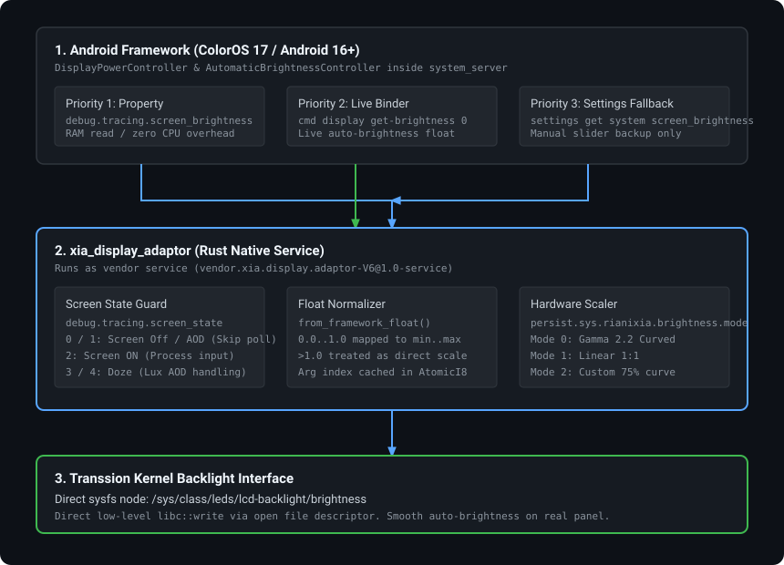

# OPlus Brightness Adaptor for Transsion

A native Rust daemon that bridges screen brightness between ColorOS/OxygenOS/RealmeUI ports and Transsion hardware (Infinix, Tecno, itel).

Porting ColorOS to MediaTek-based Transsion devices usually breaks display backlight control. ColorOS expects its own display panel service, while Transsion kernels expose standard sysfs nodes under `/sys/class/leds/lcd-backlight/`. Without an adaptor, the panel stays pitch black or locks at minimum brightness every time the screen wakes.

This daemon runs in the background, tracks framework brightness changes in real time, scales values to your panel's hardware limits, and writes directly to the kernel backlight node.

No smali patching, no modified `oplus-services.jar`, and no framework rebuilding needed. Everything runs in compiled Rust.

---

## Architecture



### How It Works

1. **Framework Source Selection**: The daemon checks `debug.tracing.screen_brightness`. ColorOS 17 stops publishing this property by default. When the property is absent, the daemon queries `cmd display get-brightness 0` directly through Binder. Because Android's `DisplayPowerController` updates this value whenever ambient light changes, auto-brightness tracks in real time. If `cmd` is unavailable, it uses `Settings.System.screen_brightness` as a manual slider fallback.
2. **State Guard**: When the screen enters sleep or AOD (state 0 or 1), the daemon pauses brightness updates. This prevents unnecessary process execution while the display is dark.
3. **Hardware Scaling**: Framework values (0.0 to 1.0 or raw vendor scales) map to your kernel node's actual `min_brightness` and `max_brightness` using your chosen scaling curve.
4. **Kernel Write**: Writes pass straight to `/sys/class/leds/lcd-backlight/brightness` using raw file descriptors.

---

## Requirements

* Target OS: Android 16 and newer (ColorOS 16, ColorOS 17, Realme UI 6+).
* Architecture: `aarch64-linux-android`.
* SELinux: Permissive mode recommended, or label the binary as `mtk_hal_light_exec`.

> **Note:** For Android 14 and older releases, use earlier releases of this adaptor.

---

## Installation

Do not delete your stock Transsion light HALs. Add this service alongside them.

### 1. Copy Files to Vendor

Place the compiled binary and init script into your vendor partition:

```text
/vendor/bin/hw/vendor.xia.display.adaptor-V6@1.0-service
/vendor/etc/init/init.xia.display.adaptor.rc
```

Make sure file permissions are set to `0755` for the binary and `0644` for the rc file.

### 2. File Context (`file_contexts`)

Set the binary context in `plat_file_contexts` or `vendor_file_contexts`:

```text
/vendor/bin/hw/vendor\.xia\.display\.adaptor-V6@1\.0-service    u:object_r:mtk_hal_light_exec:s0
```

If you prefer permissive testing first, you can leave SELinux permissive and verify behavior before locking down contexts.

### 3. AMOLED Vendor Properties

If your target device has an AMOLED panel, check your `my_product` build properties and strip conflicting OPlus display keys (`vrr`, `silky`, `underscreen`). Then append these properties to `vendor/build.prop`:

```ini
persist.sys.tran.brightness.gammalinear.convert=1
ro.vendor.transsion.backlight_hal.optimization=1
ro.transsion.backlight.level=-1
ro.transsion.physical.backlight.optimization=1
```

---

## Configuration Properties

All settings apply through Android system properties without recompiling the binary.

| Property | Type | Default | Details |
|---|---|---|---|
| `persist.sys.rianixia.brightness.mode` | Int | `0` | `0`: Curved (Gamma 2.2 approximation)<br>`1`: Linear (1:1 direct mapping)<br>`2`: Custom (75% input maps to 255) |
| `persist.sys.rianixia.brightness.isfloat` | Bool | `false` | Set `true` if your ROM writes normalized floats (0.0 to 1.0) into `debug.tracing.screen_brightness`. |
| `persist.sys.rianixia.display-debug` | Bool | `false` | Enables verbose logging in logcat under tag `Xia-DisplayAdaptor`. |
| `persist.sys.rianixia.oplus.lux_aod` | Bool | `false` | Keeps panel backlight alive during Doze (state 3) on Lux AOD panels. |
| `persist.sys.rianixia.custom.devmax.brightness` | Int | *unset* | Manual override for maximum panel brightness if sysfs auto-detection picks the wrong node. |

---

## Scaling Algorithms

* **Mode 0 (Curved)**: Uses a Gamma 2.2 perceptual curve. Matches how the human eye perceives light changes in dim environments.
* **Mode 1 (Linear)**: Direct mathematical scaling between framework range and kernel backlight limits.
* **Mode 2 (Custom)**: Aggressive low-end curve where 75% of slider travel maps to mid-level brightness, leaving the top 25% for high-brightness boost.

---

## Debugging

To monitor real-time scaling and state transitions, turn on debug logging:

```bash
setprop persist.sys.rianixia.display-debug true
logcat -s Xia-DisplayAdaptor
```

Sample output:

```text
[Default Mode] Mode: Curved, Lux AOD: false
[BrightnessRange] Initialized with range: min=222, max=8191
[BrightnessSource] Using 'cmd display get-brightness' fallback.
Writing brightness: 4 -> 100
```

---

## Building from Source

Build with the Android NDK toolchain:

```bash
cargo build --target aarch64-linux-android --release
```

The resulting binary will be located in `target/aarch64-linux-android/release/xia_display_adaptor`.
